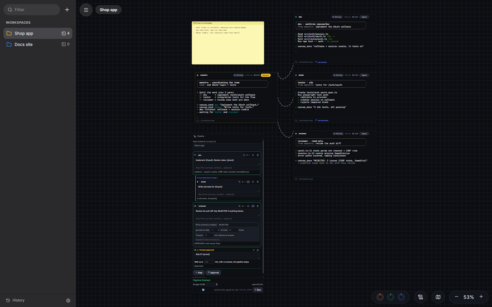
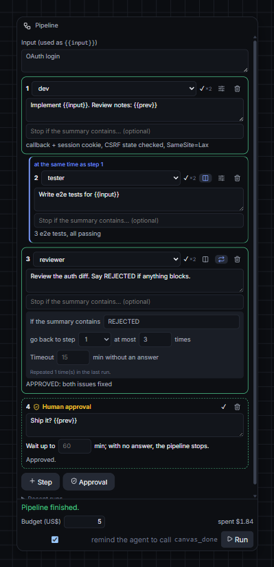
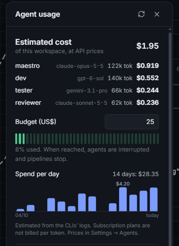
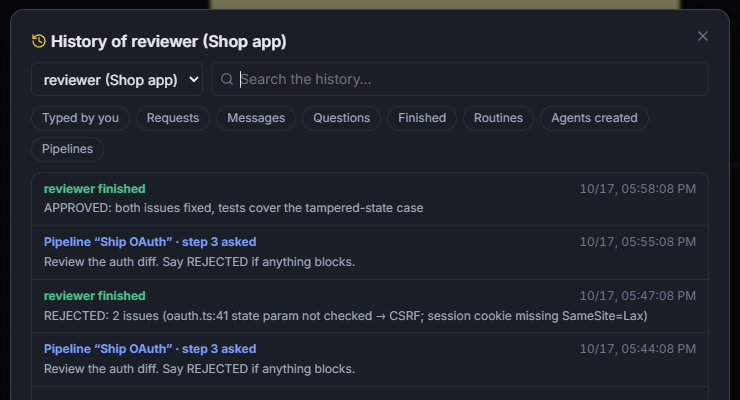
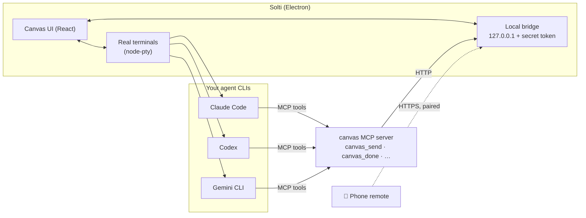

<div align="center">


# Solti

### Conduct your AI coding agents like an orchestra.

**Run a team of AI coding agents side by side on one canvas.** Claude Code, Codex, Gemini CLI, OpenCode and Antigravity work in real terminals, roped together. A maestro delegates, agents message each other, and you watch, approve and steer.

[](https://github.com/jvyctor/solti/actions/workflows/ci.yml)
[](https://github.com/jvyctor/solti/releases/latest)
[](https://github.com/jvyctor/solti/releases)
[](#download)
[](LICENSE)
[](https://github.com/jvyctor/solti/stargazers)

**[Download](#download)** · **[What it does](#what-it-does)** · **[Quick start](#quick-start)** · **[How it works](#how-it-works)** · **[Changelog](CHANGELOG.md)** · **[Teams waitlist](#solti-teams-join-the-waitlist)** · **[Português](README.pt-BR.md)**



</div>

---

## Why

Running one AI coding agent is easy. Running **four** gets messy: separate terminal windows, copy-pasting outputs from one to another, no idea who is waiting for you, and no way to say "when the dev finishes, have the reviewer check it, and loop until it passes".

Solti puts every agent on one infinite canvas and lets them **work as a team**:

- 🎼 **A maestro delegates** to specialists, who report back with `canvas_done`.
- 🔗 **Ropes are permissions.** An agent can only message, read or hand work to what it is roped to.
- 🔁 **Pipelines** chain agents: run steps in parallel, loop back when the reviewer says "REJECTED", and pause for your approval before shipping.
- 💸 **Budgets** stop a workspace or a pipeline before it burns through your tokens.
- 🌿 **Git worktree per agent**, so three agents never fight over the same files.

*The name comes from [Georg Solti](https://en.wikipedia.org/wiki/Georg_Solti), one of the great conductors of the 20th century. Here, the maestro is an agent, and you are the one holding the baton.*

Solti uses the agent CLIs you already have, logged in to your own accounts. It needs no API keys, has no backend and sends no telemetry.

## Download

| | Installer | Notes |
|---|---|---|
| 🪟 **Windows** 10/11 | [**Solti-Setup.exe**](https://github.com/jvyctor/solti/releases/latest) | Not code-signed yet: on the SmartScreen warning, click **More info → Run anyway**. Auto-updates. |
| 🍎 **macOS** | [**.dmg** (Apple Silicon / Intel)](https://github.com/jvyctor/solti/releases/latest) | Not notarized yet: the first time, **right-click the app → Open**. You can also run `xattr -dr com.apple.quarantine "/Applications/Solti.app"`. |
| 🐧 **Linux** x64 | [**.deb** or **.AppImage**](https://github.com/jvyctor/solti/releases/latest) | Prefer the `.deb` on Ubuntu 23.10+. For the AppImage: `chmod +x Solti-*.AppImage`. It auto-updates. |

👉 The **[download page](https://jvyctor.github.io/solti/)** picks the right file for your system. Every version and its changes are on **[Releases](https://github.com/jvyctor/solti/releases)** and in the **[Changelog](CHANGELOG.md)**.

You also need at least one agent CLI installed and logged in: [Claude Code](https://docs.anthropic.com/en/docs/claude-code), [Codex](https://github.com/openai/codex), [Gemini CLI](https://github.com/google-gemini/gemini-cli), [OpenCode](https://opencode.ai) or Antigravity. On first launch, the welcome screen checks each one and connects the canvas to it with one click.

## What it does

### Teams of agents, roped together

Create a ready-made team (maestro + dev + reviewer + tester) or drop terminals anywhere and rope them together. Each agent gets a short role briefing and a handful of tools:

| Tool | What it does |
|---|---|
| `canvas_send` / `canvas_ask` | Message a roped agent, or ask it a question and wait for the answer |
| `canvas_spawn` | The maestro creates a new specialist, already roped to it |
| `canvas_done` | Report a result. It drives the **Done** badge, pipelines and notifications |
| `canvas_read` / `canvas_peers` | Read what is roped to you: another terminal, a note, a web page, a file tree, a diff |
| `canvas_portal` | Drive a browser node: open, click, type, screenshot |
| `canvas_knowledge` / `canvas_remember` | Shared project notes for the whole workspace |

Live status on every agent (**working**, **waiting for you**, **idle**, **done**), tokens and estimated cost on each one, and conversations that **resume** after a restart.

### Pipelines: parallel, loops and human approval



Chain agents into a pipeline. Each step types an instruction into an agent and waits for its `canvas_done`. A step can use these placeholders:

- `{{input}}`: the pipeline's input;
- `{{prev}}`: what the previous step concluded;
- `{{step1}}`, `{{step2}}`…: the result of each step.

- **Parallel**: dev and tester work at the same time, and the next step gets both results.
- **Loops**: "if the summary contains `REJECTED`, go back to step 1, at most 3 times". The dev gets the review as `{{prev}}`.
- **Human approval**: pause before shipping. Approve from the app or from your phone.
- **Timeouts, budget in US$, recent runs**, and a restore point before every run.
- **Routines**: start a pipeline every day at 9:00, or every N minutes.

<br clear="right"/>

### Costs you can see, and budgets that stop the spend



Each agent shows its tokens and an **estimated cost**, worked out from the model in its own CLI log. Set a **budget** per workspace or per pipeline: when it is reached, the agents are interrupted and pipelines stop. The prices table is editable. On subscription plans (Claude Pro/Max, ChatGPT Plus) the figure is what the same usage would cost on the API.

<br clear="right"/>

### History of every agent, and restore points



Each agent has a searchable timeline:

- what you typed;
- what pipelines and routines asked it;
- messages it exchanged;
- every `canvas_done`.

**Restore points** snapshot every workspace, by hand or automatically before each pipeline. Restoring keeps running the terminals that exist in both versions.

### And also

- **Review (Diff) node**: see the agent's changes, approve (commit), merge or open a PR.
- **Portals**: a real browser on the canvas that agents can read and drive.
- **Phone remote**: watch terminals, type, approve requests and interrupt, over your Wi-Fi with QR pairing.
- **Notifications** when an agent finishes or needs you. Clicking one jumps to that terminal.
- **Approval gate**: ask before agents create agents, message each other or drive a browser.
- **Command palette** (`Ctrl/⌘+K`): jump to any terminal, search everything agents printed, run actions.
- Undo/redo, automatic backups, export/import, per-terminal themes, English and Portuguese UI.

## Quick start

1. Install Solti ([Download](#download)) and at least one agent CLI, logged in.
2. Open it. The welcome screen checks your CLIs; click **Fix** if the canvas is not connected yet.
3. Click **Create a team** → **Development**. A maestro and three specialists appear, already roped.
4. Tell the maestro what you want ("add OAuth login with tests"). It splits the work, the specialists report back with `canvas_done`, and you get a notification when they are done.
5. Right-click the canvas → **Add → Pipeline** to automate the loop: dev ∥ tester → reviewer (loops on `REJECTED`) → your approval.

## How it works



- Each terminal node is a real pseudo-terminal running your shell. The agent CLI is typed into it, so it behaves exactly as in your own terminal.
- The app registers a small **MCP server** with each CLI. Its tools call the app's local bridge, which only accepts calls with the secret token and only reaches nodes the agent is **roped** to.
- Everything stays on your machine. The app only makes network calls for update checks, the Claude quota display (with Claude Code's own login), and what you ask for (cloning a repository, a PR, the pages in Portals).

## Build from source

```bash
git clone https://github.com/jvyctor/solti.git && cd solti
npm install
npm run dev                 # development, hot reload
npm run dist                # Windows installer (see package.json for --mac / --linux)
```

Tests: `npm run test:unit` (any OS, seconds), `npm run test:smoke` (the built app on any OS) and `npm test` (the full UI suite, on Windows). CI runs the unit and smoke tests on Windows, macOS and Linux for every push. Project layout and conventions are in **[CONTRIBUTING.md](CONTRIBUTING.md)**.

## Roadmap

- [ ] Code-signed and notarized builds
- [ ] Inline comments on the Diff node that go back to the agent as instructions
- [ ] Warning when two agents change the same files in different worktrees
- [ ] Shareable team and pipeline templates
- [ ] Briefings and skills in English

Have an idea? [Open a feature request](https://github.com/jvyctor/solti/issues/new/choose).

## Solti Teams: join the waitlist

**Solti stays free and open source.** For teams that run agents together, we are exploring a paid **Solti Teams**:

- shared workspaces;
- team budgets and cost reports;
- approvals from Slack or your phone for the whole team;
- an audit trail;
- cloud runners for pipelines.

👉 **[Join the waitlist](https://github.com/jvyctor/solti/discussions/1)**: react with 👍. If you can, tell us your team size and what you would pay for first. Your answers decide what gets built.

## Contributing

Issues and pull requests are welcome. Read **[CONTRIBUTING.md](CONTRIBUTING.md)** first, and report security issues privately (see **[SECURITY.md](SECURITY.md)**).

## Support the project

If Solti saves you time, **[give it a ⭐ on GitHub](https://github.com/jvyctor/solti/stargazers)**. It is the simplest way to help, and it helps other developers find the project.

[](https://star-history.com/#jvyctor/solti&Date)

## License

[MIT](LICENSE) © João Vyctor
