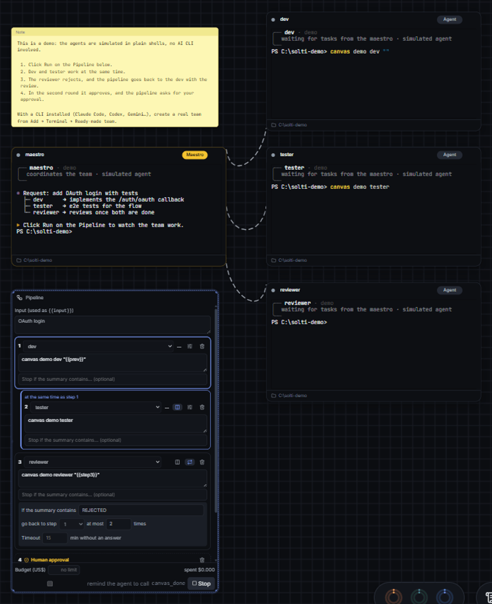
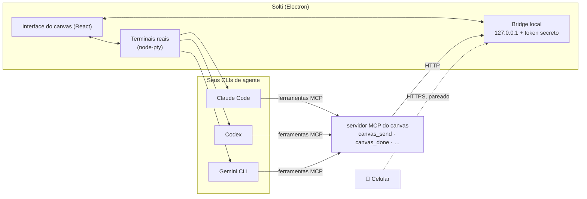

<div align="center">


# Solti

### Reja seus agentes de IA como uma orquestra.

**Rode um time de agentes de IA de programação lado a lado num só canvas.** Claude Code, Codex, Gemini CLI, OpenCode e Antigravity trabalham em terminais reais, ligados por cordas. Um maestro delega, os agentes trocam mensagens, e você acompanha, aprova e dirige.

[](https://github.com/jvyctor/solti/actions/workflows/ci.yml)
[](https://github.com/jvyctor/solti/releases/latest)
[](https://github.com/jvyctor/solti/releases)
[](#download)
[](LICENSE)
[](https://github.com/jvyctor/solti/stargazers)

**[Download](#download)** · **[O que faz](#o-que-faz)** · **[Começo rápido](#começo-rápido)** · **[Como funciona](#como-funciona)** · **[Novidades](CHANGELOG.md)** · **[Lista de espera (Teams)](#solti-teams-entre-na-lista-de-espera)** · **[English](README.md)**



<sub>A demonstração embutida, sem nenhum CLI de IA: dev ∥ testador → o revisor reprova → o fluxo volta ao dev → aprovado. Experimente em <b>Ver a demonstração</b>, num canvas vazio. (Gravada com a interface em inglês.)</sub>

</div>

---

## Por quê

Rodar um agente de IA é fácil. Rodar **quatro** vira bagunça: janelas de terminal separadas, saídas copiadas de um para o outro, nenhuma ideia de quem está esperando você, e nenhum jeito de dizer "quando o dev terminar, o revisor confere, e repete até passar".

O Solti coloca todos os agentes num canvas infinito e faz eles **trabalharem em time**:

- 🎼 **Um maestro delega** para especialistas, que respondem com `canvas_done`.
- 🔗 **As cordas são as permissões.** Um agente só fala, lê ou passa trabalho para quem está ligado a ele.
- 🔁 **Fluxos** encadeiam agentes: passos em paralelo, voltam quando o revisor diz "REPROVADO" e pausam para a sua aprovação antes de publicar.
- 💸 **Orçamentos** param um workspace ou um fluxo antes de gastar tokens demais.
- 🌿 **Worktree do git por agente**, para três agentes não disputarem os mesmos arquivos.

*O nome vem de [Georg Solti](https://pt.wikipedia.org/wiki/Georg_Solti), um dos grandes maestros do século XX. Aqui, o maestro é um agente, e quem segura a batuta é você.*

O Solti usa os CLIs de agente que você já tem, logados nas suas próprias contas. Não precisa de chave de API, não tem servidor e não envia telemetria.

## Download

| | Instalador | Observações |
|---|---|---|
| 🪟 **Windows** 10/11 | [**Solti-Setup.exe**](https://github.com/jvyctor/solti/releases/latest) | Ainda sem assinatura digital: no aviso do SmartScreen, clique em **Mais informações → Executar assim mesmo**. Atualiza sozinho. |
| 🍎 **macOS** | [**.dmg** (Apple Silicon / Intel)](https://github.com/jvyctor/solti/releases/latest) | Ainda sem notarização: na primeira vez, **botão direito no app → Abrir**. Também dá para rodar `xattr -dr com.apple.quarantine "/Applications/Solti.app"`. |
| 🐧 **Linux** x64 | [**.deb** ou **.AppImage**](https://github.com/jvyctor/solti/releases/latest) | No Ubuntu 23.10+, prefira o `.deb`. Para o AppImage: `chmod +x Solti-*.AppImage`. Ele atualiza sozinho. |

👉 A **[página de download](https://jvyctor.github.io/solti/)** escolhe o arquivo certo para o seu sistema. Todas as versões e o que mudou em cada uma estão em **[Releases](https://github.com/jvyctor/solti/releases)** e no **[Changelog](CHANGELOG.md)**.

**Pela linha de comando:**

```sh
# Windows (Scoop)
scoop bucket add solti https://github.com/jvyctor/solti
scoop install solti

# macOS (Homebrew)
brew tap jvyctor/solti https://github.com/jvyctor/solti
brew install --cask solti
```

winget (`winget install jvyctor.Solti`) e AUR (`yay -S solti-bin`) estão a caminho: veja [packaging](packaging/README.md).

Ainda não tem nenhum CLI de agente? Abra o app e clique em **Ver a demonstração**: ela roda com agentes simulados. Para trabalhar de verdade, você precisa de pelo menos um CLI de agente instalado e logado: [Claude Code](https://docs.anthropic.com/en/docs/claude-code), [Codex](https://github.com/openai/codex), [Gemini CLI](https://github.com/google-gemini/gemini-cli), [OpenCode](https://opencode.ai) ou Antigravity. Na primeira abertura, a tela de boas-vindas confere cada um e conecta o canvas a ele com um clique.

## O que faz

### Times de agentes ligados por cordas


Crie um time pronto (maestro + dev + revisor + testador) ou solte terminais em qualquer lugar e ligue-os com cordas. Cada agente recebe um briefing curto do seu papel e um punhado de ferramentas:

| Ferramenta | O que faz |
|---|---|
| `canvas_send` / `canvas_ask` | Manda mensagem a um agente ligado, ou pergunta e espera a resposta |
| `canvas_spawn` | O maestro cria um novo especialista, já ligado a ele |
| `canvas_done` | Informa um resultado. Alimenta o selo **Concluído**, os fluxos e as notificações |
| `canvas_read` / `canvas_peers` | Lê o que está ligado a você: outro terminal, uma nota, uma página web, uma árvore de arquivos, um diff |
| `canvas_portal` | Controla um nó de navegador: abre, clica, digita, tira captura |
| `canvas_knowledge` / `canvas_remember` | Anotações compartilhadas do projeto para o workspace inteiro |

Cada agente mostra o status ao vivo (**trabalhando**, **esperando você**, **ocioso**, **concluído**), exato no Claude Code graças aos hooks dele, os tokens e o custo estimado. As conversas são **retomadas** depois de reiniciar.

### Fluxos: paralelo, repetição e aprovação humana


Encadeie agentes num fluxo. Cada passo digita uma instrução num agente e espera o `canvas_done` dele. Um passo pode usar estes marcadores:

- `{{input}}`: a entrada do fluxo;
- `{{prev}}`: o que o passo anterior concluiu;
- `{{step1}}`, `{{step2}}`…: o resultado de cada passo.

- **Paralelo**: dev e testador trabalham ao mesmo tempo, e o passo seguinte recebe os dois resultados.
- **Repetição**: "se o resumo contiver `REPROVADO`, voltar ao passo 1, no máximo 3 vezes". O dev recebe a revisão em `{{prev}}`.
- **Aprovação humana**: pausa antes de publicar. Aprove no app ou pelo celular.
- **Tempo limite, orçamento em US$, últimas execuções**, e um ponto de restauração antes de cada execução.
- **Rotinas**: inicie um fluxo todo dia às 9h, ou a cada N minutos.

<br clear="right"/>

### Custos à vista, e orçamentos que param o gasto


Cada agente mostra os tokens e um **custo estimado**, calculado a partir do modelo que aparece no log do próprio CLI. Defina um **orçamento** por workspace ou por fluxo: ao atingir, os agentes são interrompidos e os fluxos param. A tabela de preços pode ser editada. Em planos por assinatura (Claude Pro/Max, ChatGPT Plus), o valor é o que o mesmo uso custaria pela API.

<br clear="right"/>

### Histórico de cada agente e pontos de restauração


Cada agente tem uma linha do tempo pesquisável:

- o que você digitou;
- o que fluxos e rotinas pediram a ele;
- as mensagens que trocou;
- cada `canvas_done`.

Os **pontos de restauração** guardam todos os workspaces, feitos à mão ou automaticamente antes de cada fluxo. Restaurar mantém rodando os terminais que existem nas duas versões.

### E mais

- **Nó de Revisão (Diff)**: veja as mudanças do agente, **comente qualquer linha** e mande os comentários de volta ao agente, aprove (commit), faça merge ou abra um PR. Um aviso aparece quando dois agentes mexem no mesmo arquivo em worktrees diferentes.
- **Modelos**: times prontos que já vêm com o fluxo (revisão de PR, bugfix com testes, documentação). Salve os seus e compartilhe como arquivo.
- **Relatório de cada execução**: todo fluxo gera um relatório em Markdown (o que cada agente fez, o custo, os arquivos alterados), pronto para virar a descrição de um PR.
- **Portais**: um navegador de verdade no canvas, que os agentes leem e controlam.
- **Controle pelo celular**: acompanhe terminais, digite, aprove pedidos e interrompa, pela sua rede Wi-Fi, com pareamento por QR code.
- **Notificações** quando um agente termina ou precisa de você. Clicar leva direto ao terminal.
- **Aprovação**: pergunta antes de agentes criarem agentes, mandarem mensagens entre si ou controlarem um navegador.
- **Paleta de comandos** (`Ctrl/⌘+K`): vá para qualquer terminal, busque tudo o que os agentes imprimiram, execute ações.
- Desfazer/refazer, backups automáticos, exportar/importar, temas por terminal, interface em português e inglês.

## Começo rápido

0. **Só quer conhecer?** Instale o Solti e clique em **Ver a demonstração**: um maestro e três agentes simulados rodam um fluxo completo (paralelo, repetição, aprovação) em shells comuns, sem nenhum CLI de IA.
1. Instale o Solti ([Download](#download)) e pelo menos um CLI de agente, já logado.
2. Abra o app. A tela de boas-vindas confere os seus CLIs; clique em **Consertar** se o canvas ainda não estiver conectado.
3. Clique em **Criar um time** → **Desenvolvimento**. Aparecem um maestro e três especialistas, já ligados.
4. Diga ao maestro o que você quer ("adicione login com OAuth e testes"). Ele divide o trabalho, os especialistas respondem com `canvas_done`, e você recebe uma notificação quando terminarem.
5. Botão direito no canvas → **Adicionar → Fluxo (pipeline)** para automatizar o ciclo: dev ∥ testador → revisor (volta se `REPROVADO`) → sua aprovação.

## Como funciona



- Cada nó de terminal é um pseudoterminal de verdade rodando o seu shell. O CLI do agente é digitado nele, então funciona exatamente como no seu terminal.
- O app registra um pequeno **servidor MCP** em cada CLI. As ferramentas dele chamam a bridge local do app, que só aceita chamadas com o token secreto e só alcança os nós **ligados** ao agente.
- Tudo fica na sua máquina. O app só acessa a rede para conferir atualizações, mostrar a cota do Claude (com o login do próprio Claude Code) e para o que você pedir (clonar um repositório, um PR, as páginas dos Portais).

## Compilar a partir do código

```bash
git clone https://github.com/jvyctor/solti.git && cd solti
npm install
npm run dev                 # desenvolvimento, com recarga automática
npm run dist                # instalador do Windows (veja o package.json para --mac / --linux)
```

Testes:
- `npm run test:unit`: qualquer sistema, leva segundos.
- `npm run test:smoke`: o app compilado, em qualquer sistema.
- `npm test`: a suíte completa de interface, no Windows.

O CI roda os testes unitários e o de fumaça em Windows, macOS e Linux a cada push. A estrutura do projeto e as convenções estão no **[CONTRIBUTING.md](CONTRIBUTING.md)**.

## Próximos passos

- [ ] Instaladores assinados e notarizados
- [ ] Comentários por linha no nó de Diff, enviados ao agente como instrução
- [ ] Aviso quando dois agentes mexem nos mesmos arquivos em worktrees diferentes
- [ ] Modelos de time e de fluxo compartilháveis

Tem uma ideia? [Abra um pedido de funcionalidade](https://github.com/jvyctor/solti/issues/new/choose).

## Solti Teams: entre na lista de espera

**O Solti continua gratuito e open source.** Para times que trabalham juntos com agentes, estamos estudando um **Solti Teams** pago:

- workspaces compartilhados;
- orçamentos e relatórios de custo por time;
- aprovações pelo Slack ou pelo celular para o time todo;
- trilha de auditoria;
- máquinas na nuvem para rodar os fluxos.

👉 **[Entre na lista de espera](https://github.com/jvyctor/solti/discussions/1)**: reaja com 👍. Se puder, conte o tamanho do seu time e o que você pagaria primeiro. As respostas decidem o que vai ser construído.

## Contribuir

Issues e pull requests são bem-vindos. Leia antes o **[CONTRIBUTING.md](CONTRIBUTING.md)**, e relate problemas de segurança em privado (veja o **[SECURITY.md](SECURITY.md)**).

## Apoie o projeto

Se o Solti economiza o seu tempo, **[deixe uma ⭐ no GitHub](https://github.com/jvyctor/solti/stargazers)**. É o jeito mais simples de ajudar, e ajuda outros desenvolvedores a encontrar o projeto.

## Política de assinatura de código (Code signing policy)

As versões de Windows são geradas e assinadas só pelo workflow de release deste repositório, com aprovação manual de cada pedido de assinatura. Veja a **[Code signing policy](CODE_SIGNING.md)** (em inglês) para saber o que é assinado, os papéis do time e a declaração de privacidade. O pedido ao programa gratuito da SignPath Foundation para open source está em andamento; até lá, os instaladores saem sem assinatura.

## Licença

[MIT](LICENSE) © João Vyctor
